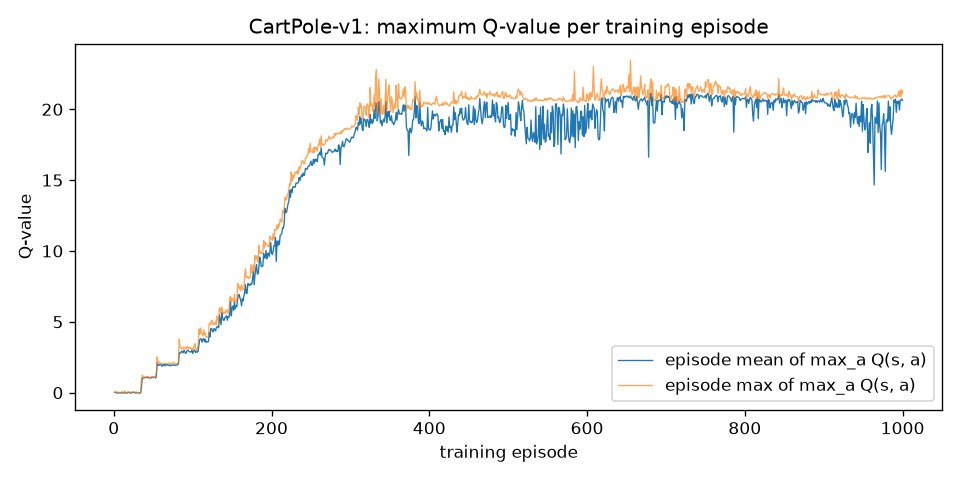
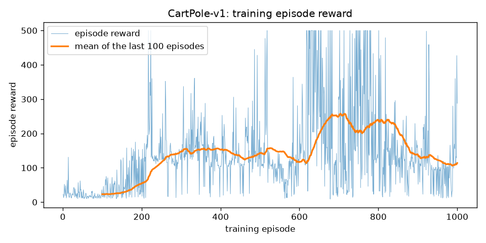
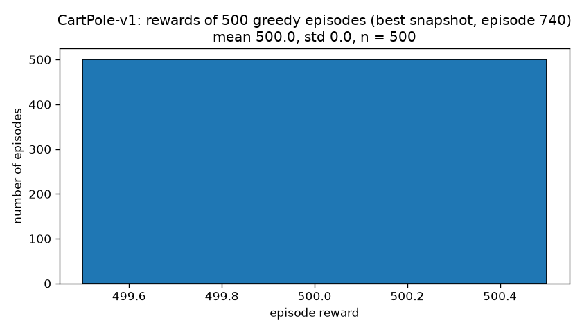
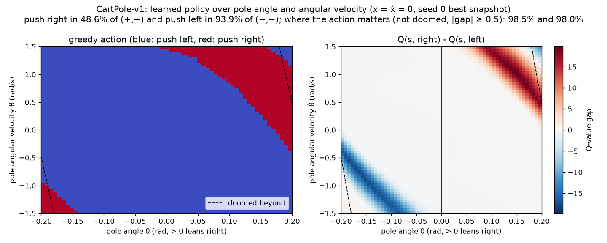
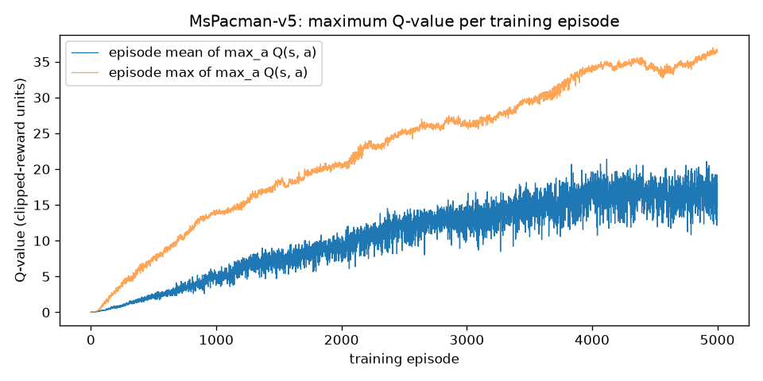
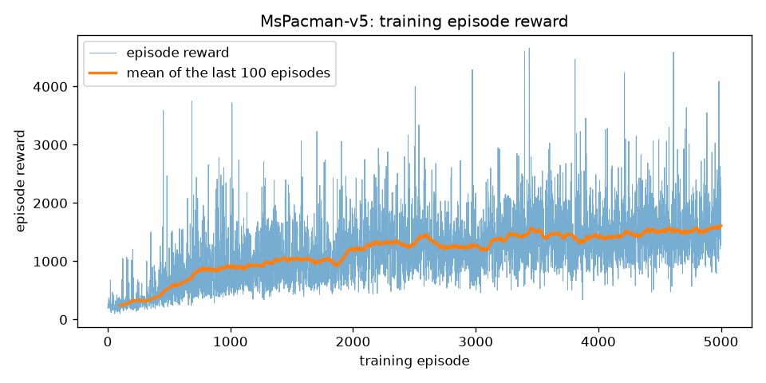
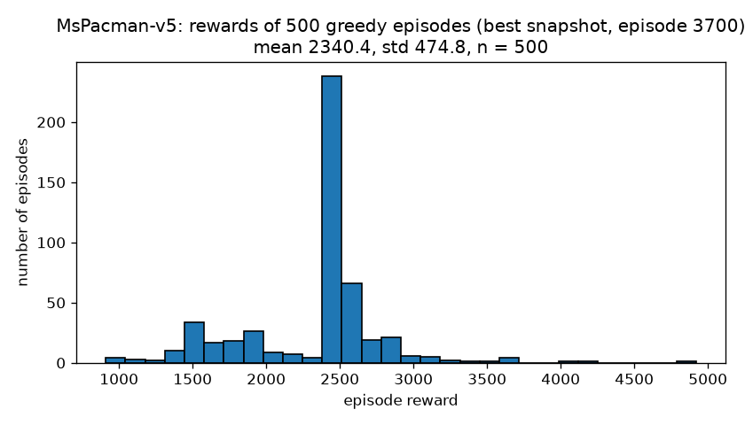
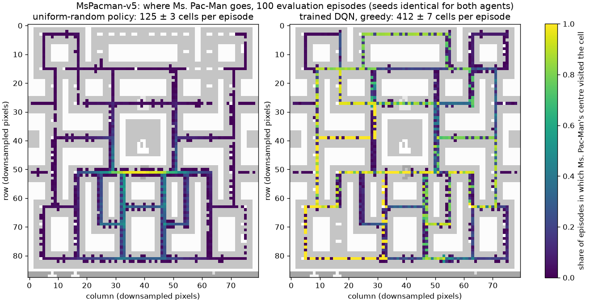
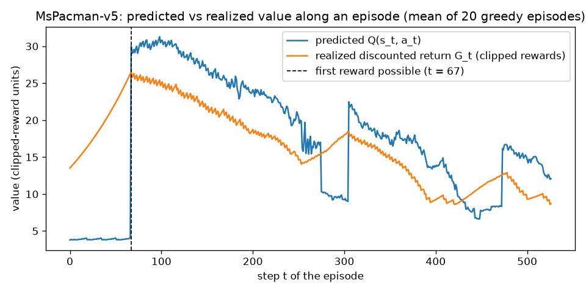

# Assignment 2: Deep Q-Network

## Repository

- GitHub username: `jmoussa99`
- Repository: `deep-q-network`
- Link: https://github.com/jmoussa99/deep-q-network

## How to run

Full details are in the repository README. On deepdish (Python 3.13, CUDA ≥ 12.8 for the Blackwell GPUs):

```bash
git clone https://github.com/jmoussa99/deep-q-network && cd deep-q-network
python3 -m venv .venv && .venv/bin/pip install -r requirements.txt

# CartPole: 3 seeds on the CPU, about 2 minutes each (seed 0 is the reported agent)
for s in 0 1 2; do .venv/bin/python dqn.py --env CartPole-v1 --seed $s --episodes 1000 --out results/cartpole_s$s & done; wait

# MsPacman: one GPU, about 1.5 hours for 5,000 episodes (--hours is a safety stop)
CUDA_DEVICE_ORDER=PCI_BUS_ID CUDA_VISIBLE_DEVICES=1 .venv/bin/python dqn.py --env ALE/MsPacman-v5 --seed 0 \
    --episodes 5000 --hours 17 --device cuda --out results/mspacman

# Validation (each prints a PASS/FAIL table and writes results/validation_<group>.json)
CUDA_VISIBLE_DEVICES= .venv/bin/python validate_dqn.py checks      # edge cases and algorithm checks, about 25 s
CUDA_VISIBLE_DEVICES= .venv/bin/python validate_dqn.py cartpole    # CartPole experiments, about 5 min the first time
CUDA_DEVICE_ORDER=PCI_BUS_ID CUDA_VISIBLE_DEVICES=1 .venv/bin/python validate_dqn.py mspacman
```

Each run folder holds `train.csv` (one row per episode), `eval.csv` (500 greedy evaluation episodes), `metrics.json`,
`q_values.png`, `rewards.png` and `eval_hist.png`. `python dqn.py --out <run> --eval-only` rebuilds the evaluation and
the plots from the saved model.

The README's "Validation" section documents every check: what it does, how it validates, and its expected outcome
with the source of that expectation. Each expectation was written down before the check first ran. Sections 2 to 5
below give the results.

## 1. Implementation

One implementation (`dqn.py`) serves both games. The only differences are the settings in `ENVS` and the network
input.

- **Q-network.** CartPole: MLP 4 → 128 → 128 → 2 (ReLU). MsPacman: the Nature-DQN convolutional network on a stack of
  the last 4 preprocessed frames (4×88×80 → conv 32@8×8/4 → 64@4×4/2 → 64@3×3/1 → 512 → 9). Frames come from the
  assignment's `preprocess_observation`, are stored as int8, and are scaled to [−1, 1) on the GPU.
- **Replay buffer.** Uniform sampling from preallocated arrays (CartPole 50k, MsPacman 100k transitions). When the
  buffer is full, the oldest transition is overwritten. Learning starts after a warm-up (1k / 20k transitions).
- **Target network.** A copy of the online network that the optimizer never sees. It is overwritten by the online
  weights every C environment steps (CartPole 500, MsPacman 10,000).
- **Update.** TD target y = r + γ(1 − d)·max_a′ Q_target(s′, a′), Huber (smooth-L1) loss, Adam, gradient-norm clipping
  at 10. MsPacman learns every 4 steps with batch 32, CartPole every step with batch 64.
- **Exploration.** ε-greedy with ε decaying linearly from 1.0 to 0.05 over 10k steps (CartPole) and from 1.0 to
  0.1 over 500k steps (MsPacman). Evaluation is greedy (ε = 0).
- **Rewards.** Learning uses rewards clipped to their sign (the DQN standard, which keeps MsPacman's 10 to 1,600-point
  rewards on one scale). Every plotted or reported score is the raw game score.
- **Episode ends.** d = 1 only for a real termination (pole fallen or cart off the track, game over). A time-limit
  truncation ends the episode but keeps d = 0, so the target still bootstraps. Losing a MsPacman life is not terminal.
- **Snapshot selection.** Every 20 (CartPole) or 100 (MsPacman) episodes, the network plays 10 greedy episodes on
  dedicated selection seeds, and the best-scoring weights are kept. The 500 evaluation episodes use different seeds,
  so the selection cannot inflate the reported numbers. The final weights are evaluated too whenever they differ,
  which makes a late collapse visible.
- **Seeds.** Training episode k of seed s resets with s·10⁶ + k, evaluation episode i with 10⁹ + i, selection with
  2·10⁹ + i, and validation-only episodes with 3·10⁹ + i. The `seed_disjoint` check confirms these ranges are
  disjoint.
- **Robustness.** A non-finite loss or Q-value stops the run with the episode and step. Each finished episode is
  flushed to `train.csv`, and `model.pt` is replaced atomically. `--eval-only` rebuilds every output from those
  files, and `--hours` stops training at a wall-clock limit.
- **The maximum Q-value plot** shows, per training episode, the mean and the max over visited states of
  max_a Q(s, a), computed with the online network at every step (also on random-action steps).

## 2. CartPole-v1 (γ = 0.95)

### Solution

DQN as in section 1 with an MLP 4 → 128 → 128 → 2, Adam lr 1e-3, batch 64, buffer 50k, target sync every 500 steps,
ε 1.0 → 0.05 over 10k steps, and 1,000 training episodes. Every 20 episodes, a 10-episode greedy check on the
selection seeds picks the best snapshot. Seed 0 is the reported agent, fixed before the runs. Seeds 1 and 2 show the
spread.

| seed | best snapshot (episode) | 500 greedy episodes: mean ± std | share at 500 | final weights: mean ± std |
|---|---|---|---|---|
| **0** | 740 | **500.0 ± 0.0** | **100%** | 140.3 ± 2.7 |
| 1 | 920 | 500.0 ± 0.0 | 100% | 106.8 ± 2.5 |
| 2 | 600 | 499.9 ± 1.3 | 98.4% | 304.0 ± 32.0 |

(`results/cartpole_s{0,1,2}/metrics.json`)

**The seed-0 network solves CartPole:** all 500 evaluation episodes reach the 500-step limit.







**Reading the plots.**

- **Q-values.** The maximum Q-value rises in steps of about 1 during the first 120 episodes, one step per target
  sync. With a hard target network, each sync applies the Bellman operator once more, so after k syncs
  Q ≈ Σ_{i<k} γ^i: value iteration made visible. It then levels off at 20 to 21, matching the prediction
  1/(1−γ) = 20 for a pole that does not fall. The γ = 0.5 control run (`results/val_cartpole_gamma0.5/q_values.png`) shows
  the same staircase with plateaus at about 1, 1.5 and 1.75 (the partial sums of 0.5^i), before it settles at 2.
- **Training reward.** The reward (collected with ε = 0.05) climbs to about 150, jumps to about 250 between
  episodes 620 and 830 with many 500-step episodes, and then falls back to about 115. This rise and fall is the
  well-known instability of DQN on CartPole.
- **Evaluation.** The histogram has a single bar, because every evaluation episode scores 500.

**How the settings were chosen** (`results/pilot_cartpole/`, every variant changes one setting):

| variant | seeds | best-snapshot evaluation per seed | mean |
|---|---|---|---|
| lr 1e-3, 600 episodes (first plan) | 0, 1, 2 | 396.6, 297.9, 499.9 | 398.1 |
| lr 2.5e-4, 600 episodes | 10, 11, 12 / 0, 1, 2 | 500.0, 500.0, 499.9 / 301.5, 356.7, 404.4 | 427.1 |
| target sync 2,000, 600 episodes | 10, 11, 12 | 499.6, 195.8, 322.3 | 339.2 |
| lr 2.5e-4, 1,000 episodes | 13 to 17 | 495.3, 258.6, 500.0, 247.8, 500.0 | 400.3 |
| **lr 1e-3, 1,000 episodes (final)** | 10 to 17 | 500.0, 500.0, 490.7, 500.0, 500.0, 500.0, 500.0, 500.0 | **498.8** |

- The first plan (600 episodes) missed 475 on seed 0, so each variant was piloted on other seeds, which avoids
  tuning on the reported seed.
- The pre-set rule first picked lr 2.5e-4, and it then failed on seeds 0 to 2. Its "perfect" pilot snapshots were
  early and unconverged (Q(s₀) ≈ 3.8 instead of 20).
- A larger pilot (8 seeds) then chose 1,000 episodes at lr 1e-3. The reported seeds were run only after the choice.

### Non-standard plot: what the network learned



- **What the map shows.** The greedy action (left) and Q(right) − Q(left) (right) of the seed-0 agent, over pole
  angle θ and angular velocity θ̇ with the cart at rest in the center.
- **The two bands.** The action matters only in two diagonal bands, where the pole is falling fast enough that the
  choice decides failure within the effective horizon of about 1/(1−γ) = 20 steps. There the network pushes in the
  direction of the fall, as the physics requires: 98.5% / 98.0% of those cells.
- **Near-ties.** Elsewhere the two actions are worth almost the same, and the argmax is a near-tie. This includes
  the region beyond the dashed lines, where the pole falls at the next step whatever the action.
- **Consequence.** This explains the training instability. Over most of the state space the policy is decided by
  differences of a few hundredths, so small weight changes flip it.

### Edge cases and how they were handled

| edge case | handling | evidence |
|---|---|---|
| Time limit at 500 steps vs a real failure | `truncated` ends the episode with d = 0 (bootstrap). Only `terminated` gives d = 1 | `truncation_bootstrap`, `termination_terminal` (checks) |
| Two ways to fail (pole angle, cart position) | both are terminal. The failure analysis shows the agent's real failure mode is the cart leaving the track | `end_causes_posthoc`: best snapshot 100/100 at the time limit, final weights 100/100 cart off track |
| γ = 0.95 is short-sighted | a failure k steps ahead changes Q by only 20·γ^k (0.12 at k = 100), so the slow cart drift is barely visible to the agent | policy map (gap ≈ 0 near upright), end causes |
| Late-training collapse (final weights fail at 107 to 304) | best-snapshot selection on dedicated seeds, plus evaluation of the final weights so the collapse is reported, not hidden | table above |
| Selection bias | selection seeds (2·10⁹ + i) are disjoint from evaluation seeds (10⁹ + i) | `seed_disjoint` |
| All 500 evaluation scores equal | the histogram draws one bar centered on the value, std 0 | `histogram_single_value`, seed-0 histogram |
| Fewer than 100 episodes for the moving average | no line instead of a wrong one (`np.convolve` would silently swap its arguments) | `moving_average_alignment` |
| Reward on the failure step | Gymnasium also pays +1 on the terminating step, so the terminal target is exactly 1 | trace, chain-MDP check |

### Tests: is the agent right, and right for the right reasons? (`validate_dqn.py cartpole`)

Expectations were written down before each test ran (see the README for the source of each).

| test | expected | observed | result |
|---|---|---|---|
| solved (seed 0) | mean ≥ 475 | 500.0 ± 0.0, 100% at 500 | PASS |
| Q scale vs γ (last 50 episodes, max Q ÷ 1/(1−γ)) | in [0.9, 1.15], increasing | γ 0.5: 2.02 (1.012), γ 0.9: 10.30 (1.030), γ 0.95: 20.88 (1.044) | PASS |
| Q(s₀, a₀) vs realized return G₀ | within 10% | 20.856 vs 20.000 (1.043) | PASS |
| lr = 0: weights unchanged | identical | identical | PASS |
| lr = 0: no better than random play | ≤ random + 3 SE = 24.4 | 91.1 | **FAIL (wrong expectation)** |
| lr = 0 equals the untrained network; trained ≫ lr 0 (post-hoc) | equal; > 3 SE | 91.078 = 91.078; 500 vs 91 | PASS |
| trained only on random actions (ε = 1) | > random + 3 SE | 181.4 ± 5.2 vs 22.7 ± 0.6 | PASS |
| physics: push toward the fall, whole quadrants | ≥ 95% / ≥ 95% | 48.6% / 93.9% | **FAIL (wrong expectation)** |
| physics where the action matters (post-hoc) | ≥ 95% / ≥ 95% | 98.5% / 98.0% | PASS |

What the tests show:

- **The value scale responds to γ exactly as theory predicts.** Changing γ from 0.5 to 0.9 to 0.95 moves the Q
  plateau to 2.02, 10.30 and 20.88, i.e. 1.2% to 4.4% above 1/(1−γ). That small upward bias is the expected
  overestimation of the max operator. Q at the start state matches the return actually earned within 4.3%.
- **Learning comes from the gradient, and it is off-policy.** With learning rate 0 the weights do not move.
  Training on purely random behavior still produces a greedy policy that balances 8 times longer than random play
  (181 vs 23 steps), which can only come from the max in the Q-learning target.
- **Two of my predictions were wrong, and both failures taught something.**
  - The untrained network is not "random play": it is a fixed controller, and the seed-0 initialization balances
    for 91 steps. Its training curve still rises from 50 to 90, purely because ε decays toward that fixed policy,
    so a rising training curve alone is no proof of learning.
  - The physics test failed because near upright, and in doomed states, both actions are worth the same. Restricted
    to states where the action matters, the agent follows the physics 98% of the time. The restricted tests were
    defined after seeing the failures, so they are supporting evidence only. Both FAILs stay in
    `results/validation_cartpole.json`.

**First 10 steps** (`results/trace_cartpole.txt`, untrained network, ε ≈ 1):

```
CartPole-v1 seed 3000000000 {}: episode length 24, score 24.0
t=0 s [-0.01  -0.02  -0.031  0.031] Q [ 0.002 -0.043] eps 1.0000 a 1 r_raw 1 r 1 d 0 y 1.0069
t=1 s [-0.01   0.175 -0.031 -0.271] Q [ 0.007 -0.056] eps 0.9999 a 0 r_raw 1 r 1 d 0 y 1.0046
t=2 s [-0.007 -0.02  -0.036  0.012] Q [ 0.005 -0.044] eps 0.9998 a 0 r_raw 1 r 1 d 0 y 0.9885
t=3 s [-0.007 -0.214 -0.036  0.293] Q [-0.012 -0.036] eps 0.9997 a 1 r_raw 1 r 1 d 0 y 1.0057
t=4 s [-0.011 -0.019 -0.03  -0.011] Q [ 0.006 -0.045] eps 0.9996 a 1 r_raw 1 r 1 d 0 y 1.0092
t=5 s [-0.012  0.177 -0.03  -0.313] Q [ 0.01  -0.058] eps 0.9995 a 1 r_raw 1 r 1 d 0 y 1.0128
t=6 s [-0.008  0.373 -0.036 -0.615] Q [ 0.013 -0.068] eps 0.9994 a 0 r_raw 1 r 1 d 0 y 1.0124
t=7 s [-0.001  0.178 -0.049 -0.334] Q [ 0.013 -0.06 ] eps 0.9993 a 1 r_raw 1 r 1 d 0 y 1.0158
t=8 s [ 0.003  0.374 -0.055 -0.641] Q [ 0.017 -0.07 ] eps 0.9992 a 1 r_raw 1 r 1 d 0 y 1.0196
t=9 s [ 0.01   0.57  -0.068 -0.951] Q [ 0.021 -0.073] eps 0.9991 a 0 r_raw 1 r 1 d 0 y 1.0206
```

- Every reward is 1 and d = 0, so each TD target is y = 1 + 0.95·max_a Q_target(s′, a) ≈ 1.0 while Q ≈ 0.
- The cart velocity (2nd component) changes by about ±0.195 per push, and the pole's angular velocity (4th) moves
  the opposite way, as the dynamics require.

## 3. MsPacman-v5 (γ = 0.99)

### Solution

DQN as in section 1 on the assignment's preprocessed frames (88×80, int8), with the last 4 frames stacked as the
state. Settings:
- Nature-DQN convolutional network, Adam lr 1e-4, batch 32, one update every 4 agent steps.
- Replay buffer of 100k transitions after a 20k-step warm-up; target sync every 10k steps.
- ε 1.0 → 0.1 over the first 500k steps; rewards clipped to their sign for learning.
- Snapshot check every 100 episodes (10 greedy episodes).

The default `ALE/MsPacman-v5` keeps sticky actions (25%) and frame skip 4. The run used 5,000 training episodes
(3.47M agent steps, 79 minutes) on one RTX PRO 5000 (`CUDA_VISIBLE_DEVICES=1`). A 200-episode pilot
(`results/mspacman_pilot`) checked speed (725 steps/s with learning) and that Q stays finite before the main
run. A decision point at episode 1,000 (last-100 mean 914.3 vs first-100 mean 240.9,
z = 12.6) confirmed learning, so no fallback was needed.

| | mean ± std | SE | min / max |
|---|---|---|---|
| **500 greedy episodes, best snapshot (episode 3,700)** | **2,340.4 ± 474.8** | 21.2 | 910 / 4,920 |
| 500 greedy episodes, final weights (episode 5,000) | 1,809.1 ± 425.8 | 19.0 | 1,210 / 3,660 |
| uniform-random policy, same 500 seeds | 262.4 ± 146.1 | 6.5 | |
| training, first 100 episodes (ε ≈ 0.9) | 240.9 | 8.2 | |
| training, last 100 episodes (ε = 0.1) | 1,614.0 | 51.7 | |

(`results/mspacman/metrics.json`, `results/validation_mspacman.json`)







**Reading the plots.**

- **Training reward.** The 100-episode mean rises from about 240 (random play) to about 1,600 and is still creeping
  up at episode 5,000.
- **Q-values.** The Q curves rise smoothly with no divergence. The episode max of max_a Q reaches about 36, far
  below the bound 1/(1−γ) = 100 that clipped rewards impose. It has not levelled off, so a longer run may
  improve further.
- **Evaluation histogram.** The histogram of the best snapshot has a spike: 45.6% of the 500 evaluation episodes score
  between 2,400 and 2,500 (108 score exactly 2,460, 91 exactly 2,450). Ms. Pac-Man's ghosts are nearly
  deterministic, so a greedy policy mostly replays one learned route, and the sticky actions only sometimes push it
  onto a different path. The final weights give more varied scores (median 1,695, 1.2% in that range).

### Non-standard plots



- **Position heatmap.** Ms. Pac-Man's position in every frame (the centroid of her (210, 164, 74) pixels), drawn as
  the share of 100 episodes in which she passed through each maze cell. Both agents play the same 100 seeds.
- **What it shows.** The random agent rarely leaves the area around its start. The trained agent sweeps the whole
  maze along consistent routes: 412 ± 7 distinct cells per episode vs 125 ± 3 (z = 38.6). The bright, consistently used corridors fit the
  single dominant route suggested by the histogram.



- **Predicted vs realized value along an episode** (mean of 20 greedy episodes). Q(s_t, a_t) against the realized
  discounted return of the clipped rewards, G_t.
- **During play,** Q runs about 20% above G (ratio 1.21). That is the overestimation expected from the max operator in
  the target. It is larger than on CartPole (4%), which is consistent with the max being taken over 9 noisy action
  values instead of 2, and with the longer horizon (γ = 0.99). This explanation is not tested.
- **During the opening,** the first 67 steps of every episode, no reward is possible and actions have no effect.
  There the network predicts about 3.9 while the realized return rises from 13 to 27 (ratio 0.20).
- **During the pauses after a life is lost,** Q drops in a similar way. The network undervalues the phases in which
  it cannot act. This is an observation; the cause was not tested.

### Edge cases and how they were handled

| edge case | handling | evidence |
|---|---|---|
| The given preprocessing sums uint8 into uint64, so `img // 3 − 128` wraps around | kept verbatim. The int8 cast keeps the low 8 bits, so the result is still exact | `preprocess_exact`: 483 / 483 frames equal the signed-int64 formula |
| Preprocessing could write into the environment's frame | `sum` returns a new array, so it cannot | `preprocess_raw_unchanged` |
| The contrast step erases every pixel with RGB sum 448, not only Ms. Pac-Man | measured: no other object has that sum | `mspacman_color_unique`: 0 foreign pixels; she is visible in 100% of frames |
| One frame carries no motion (ghost direction) | stack of 4 frames, filled with copies of the first frame at reset, so nothing leaks from the previous episode | `frame_stack_reset`, trace (frame ids shift by one each step) |
| 3 lives: losing one is not game over | d = 1 only at game over. A life loss continues the episode and bootstraps | `life_loss_not_terminal`: lives drop at steps 194, 350 and 482, and d = 1 only at 482 |
| Time limit of 108,000 frames (27,000 agent steps) | would be a truncation (d = 0, bootstrap). It never occurred: the longest episode had 1,697 steps (training) and 1,339 (evaluation) | same code path as `truncation_bootstrap` |
| Rewards from 10 to 1,600+ points | learning uses sign-clipped rewards. Every reported score is raw | `reward_clip_vs_score` |
| Sticky actions (25%): the executed action is not always the chosen one | kept for training and evaluation, as the v5 default requires. They are switched off only for the determinism trace | `trace_mspacman_deterministic` |
| A 67-step uncontrollable opening in every episode | not changed. Found by validation: it is where the network's values are most wrong | `q0_vs_g0` (FAIL), `q_vs_return_posthoc` |
| The greedy policy collapses onto one route | reported: the evaluation is a mix of one dominant route and its sticky-action variations | histogram spike, heatmap |
| Late-training drift (final weights 1,809 vs best 2,340) | best-snapshot selection on dedicated seeds, with both evaluated | table above |

### Tests (`validate_dqn.py mspacman`)

| test | expected | observed | result |
|---|---|---|---|
| last 100 training episodes vs random | z > 3 | 1,614.0 ± 51.7 vs 262.4 ± 6.5, z = 25.9 | PASS |
| 500 evaluation episodes vs random | z > 3 | 2,340.4 ± 21.2 vs 262.4 ± 6.5, z = 93.5 | PASS |
| last 100 vs first 100 training episodes | z > 3 | 1,614.0 vs 240.9 ± 8.2, z = 26.2 | PASS |
| maze cells visited per episode, trained vs random | z > 3 | 412 ± 7 vs 125 ± 3, z = 38.6 | PASS |
| all logged Q-values inside [−1, 100] | yes | [0.03, 36.94] | PASS |
| Q(s₀, a₀) vs realized return G₀ | ratio in [0.5, 2] | 3.79 vs 13.52 (0.28) | **FAIL (unanticipated edge case)** |
| Q vs G over every step (post-hoc) | ratio in [0.5, 2] | all 1.07, opening 0.20, play 1.21 | PASS |

What the tests show:

- **Learning is unambiguous.** Every comparison with random play, and with the first training episodes, is more than
  25 standard errors apart. The coverage test shows that the improvement is the agent clearing the maze, not
  exploiting one spot.
- **The value scale is right.** Q stays inside the range that clipped rewards allow, and over whole episodes it
  matches the realized returns within 7%.
- **The one FAIL is informative.** I compared values at the start state because it is a clean, comparable point in
  every episode, and it turned out to be the least representative state in the game. Q(s₀, a₀) is identical in all
  500 evaluation episodes (3.79, std 0): with sticky actions irrelevant before play begins, every episode starts
  identically. The FAIL stays in `results/validation_mspacman.json`. The whole-trajectory test was defined after it.

**First steps** (`results/trace_mspacman.txt`, untrained network, ε = 1, sticky actions off):

```
ALE/MsPacman-v5 seed 3000000000 {'env_kwargs': {'repeat_action_probability': 0.0}}: episode length 515, score 280.0
t=0 frames [0, 0, 0, 0] Q [ 0.001 -0.042 -0.001 -0.027 -0.029  0.033 -0.02  -0.002 -0.007] eps 1.0000 a 4 r_raw 0 r 0 d 0 lives 3 y 0.0328
t=1 frames [0, 0, 0, 1] Q [ 0.001 -0.042 -0.002 -0.027 -0.028  0.033 -0.02  -0.002 -0.007] eps 1.0000 a 2 r_raw 0 r 0 d 0 lives 3 y 0.0325
t=2 frames [0, 0, 1, 2] Q [ 0.001 -0.042 -0.001 -0.027 -0.028  0.033 -0.02  -0.002 -0.007] eps 1.0000 a 1 r_raw 0 r 0 d 0 lives 3 y 0.0327
t=3 frames [0, 1, 2, 3] Q [ 0.001 -0.043 -0.002 -0.027 -0.029  0.033 -0.019 -0.002 -0.007] eps 1.0000 a 7 r_raw 0 r 0 d 0 lives 3 y 0.0327
t=4 frames [1, 2, 3, 4] Q [ 0.001 -0.042 -0.001 -0.028 -0.029  0.033 -0.019 -0.002 -0.007] eps 1.0000 a 8 r_raw 0 r 0 d 0 lives 3 y 0.0328
```

- The frame ids show the 4-frame stack starting as 4 copies of the reset frame and shifting in one new frame per
  step.
- With an untrained network all Q-values are about 0, so every TD target is y = 0 + 0.99·max Q_target(s′) ≈ 0.03,
  and no reward appears in the opening steps.

## 4. Edge cases at a glance (both games)

| # | edge case | game | how it is handled | how it is verified |
|---|---|---|---|---|
| 1 | time-limit truncation vs real termination | both | d = `terminated` only: truncation bootstraps, failure does not | `truncation_bootstrap`, `termination_terminal`, chain-MDP Q* |
| 2 | losing a life | MsPacman | not terminal; only game over is | `life_loss_not_terminal` |
| 3 | first state of an episode (no frame history) | MsPacman | stack of 4 copies of the reset frame | `frame_stack_reset`, trace |
| 4 | unsigned overflow in the given preprocessing | MsPacman | verified exact, kept verbatim | `preprocess_exact` |
| 5 | contrast step erasing other objects | MsPacman | verified that only Ms. Pac-Man has RGB sum 448 | `mspacman_color_unique` |
| 6 | rewards on very different scales | MsPacman | sign-clipped for learning, raw for reporting | `reward_clip_vs_score`, `q_bounds` |
| 7 | sticky actions (stochastic execution) | MsPacman | kept (v5 default); off only for the determinism trace | `trace_mspacman_deterministic` |
| 8 | uncontrollable 67-step opening | MsPacman | found by validation; values there are underestimated | `q0_vs_g0` (FAIL), `q_vs_return_posthoc` |
| 9 | sampling a buffer that is not full, or has wrapped | both | uniform over filled slots only; learning starts after a warm-up ≥ batch | `buffer_partial`, `buffer_wrap` |
| 10 | target network accidentally trained or shared | both | separate copy that the optimizer never sees, hard sync every C steps | `target_sync` |
| 11 | divergence (NaN/inf) | both | stop with the episode and step; never train on non-finite values | `divergence_guard` |
| 12 | late-training collapse | both | best snapshot on dedicated seeds; final weights also evaluated | CartPole 500 vs 140; MsPacman 2,340 vs 1,809 |
| 13 | selection inflating the reported score | both | selection, evaluation, training and validation seeds are disjoint | `seed_disjoint` |
| 14 | short-sighted γ = 0.95 (cart drift invisible) | CartPole | 1,000 episodes plus snapshot selection; the failure mode is analysed | `end_causes_posthoc`, policy map |
| 15 | all evaluation scores equal | CartPole | single-bar histogram, std 0 | `histogram_single_value`, seed-0 histogram |
| 16 | fewer than 100 episodes for the moving average | both | no line (numpy would silently swap the arguments) | `moving_average_alignment` |
| 17 | interrupted or time-limited run near the deadline | both | per-episode log, atomic model file, `--eval-only`, `--hours` | `interrupted_run`, `wall_clock_stop` |
| 18 | ε schedule ends | both | linear, then constant; evaluation greedy | `epsilon_bounds` |

## 5. Is the implementation itself correct? (`validate_dqn.py checks`, 27/27 PASS)

These checks test the code paths that training uses, on real environment data, against expectations from outside
the code: closed form, hand calculation, Gymnasium and ALE rules, or the assignment's formula.

| area | check: expected → observed |
|---|---|
| TD update | **5-state chain MDP with known Q\*** (γ = 0.9, goal reward 1, terminal). The training function `learn()` on all 8 transitions converges to the closed form V\*(s) = 0.9^(3−s), Q\*(s, left) = 0.9·V\*(max(s−1, 0)): max error 1.04e-06, greedy action "right" in every state, Q(3, right) = 1.000000 (the terminal transition has no bootstrapped term). Hand-set target network: targets [5.5, 2.0] as computed by hand |
| target network | with sync period 100, the target is constant inside each window, equal to the online network right after each sync (steps 100, 200, 300), and different from it otherwise |
| episode ends | CartPole cut by a 20-step time limit while the pole is up: last d = 0 (bootstrap). Pole fallen (θ = −0.227 < −0.2095): d = 1 only at the last step. MsPacman: lives drop at steps 194, 350 and 482 of one episode, and only the game-over step (482) has d = 1 |
| preprocessing | the assignment's function equals the same formula in signed int64 on 483 / 483 frames, even though its uint64 arithmetic wraps around. The raw frames are unchanged. No pixel other than Ms. Pac-Man's (210, 164, 74) has the erased sum 448. She is visible and forms one compact sprite in 100% of frames |
| frame stack | the first state of episode 2 is 4 copies of its own first frame, none from episode 1. The trace shows the 4 frame ids shift by one each step: [0,0,0,0] → [0,0,0,1] → [0,0,1,2] … |
| rewards | stored reward = sign(raw reward) (raw {0, 10} → {0, 1}), score = sum of raw rewards (220 = 220) |
| replay buffer | capacity 5 holding 3: samples only {1, 2, 3}. After 8 adds: holds {4, …, 8} |
| ε schedule | [1.0, 0.525, 0.05, 0.05] and [1.0, 0.55, 0.1, 0.1] at steps 0, decay/2, decay, 10·decay |
| robustness | lr = 1e30 stops at "episode 35, global step 1000" (the first update) with the earlier files intact. A 2-second wall-clock limit stops after the current episode with all outputs. A SIGKILL mid-run leaves a log with episodes 1..k exactly once, and `--eval-only` rebuilds everything |
| reproducibility | two CPU runs with the same seed give identical logs and weights. Re-running the README CartPole commands reproduced all three runs bit for bit. Training, selection, evaluation and validation seeds are disjoint |
| plots | the moving average starts at episode 100 with the mean of episodes 1 to 100 (50.5 for 1..150) and is empty for short runs. A histogram of 500 equal scores is one bar with std 0 |
| determinism | two MsPacman traces with sticky actions off are identical |

## 6. Given three more months: further validation and experiments

1. **More seeds, and confidence bands for MsPacman.** One MsPacman run cannot separate the algorithm from seed luck.
   I would use 5 to 10 seeds, report learning curves with bootstrap bands, and compare with published DQN results
   under the same protocol (sticky actions, 50M frames).
2. **Train much longer.** 5,000 episodes is about 3M agent steps, a fraction of the original 50M frames. Do the
   curve and the max-Q plot saturate, or are they still rising?
3. **Ablations, one change at a time.** Double DQN, dueling heads, prioritized replay, n-step returns, target-sync
   period, buffer size, treating life loss as terminal, and reward clipping vs scaling. For the last one: does an
   unclipped agent learn to hunt ghosts?
4. **An overestimation study.** Compare Q(s, a) with Monte Carlo returns along whole trajectories, not just at s₀,
   by game phase. Check whether Double DQN removes the 1 to 4% bias seen on CartPole and the bias measured on MsPacman.
5. **Understand the CartPole collapse.** Track the action gap and the share of near-edge states in the buffer over
   training. Test whether a larger buffer, lr annealing, or a larger γ (which makes the cart drift visible to the
   value function) removes the collapse. Measure how reliable snapshot selection is over 30+ seeds.
6. **Robustness tests.** Change pole length and mass, observation noise and starting states for CartPole. Change the
   sticky-action probability and game modes for MsPacman. Does the policy still work?
7. **What the MsPacman network looks at.** Saliency maps (gradient of Q with respect to the pixels), and hand-built
   states (a ghost approaching from one side) to check that Q prefers moving away, and toward frightened ghosts.
8. **Calibrate the tests themselves.** Two of my expectations were wrong. Placebo runs (shuffled rewards, frozen
   networks) would measure each test's false-alarm rate before it is trusted, and pre-registering criteria on
   pilot seeds would avoid post-hoc rules.
